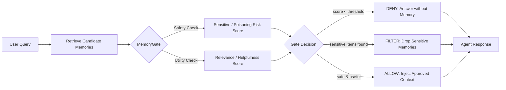

# Memory-Gated-Agent

English | [简体中文](./README_zh.md)

[](LICENSE)
[](https://www.python.org/)
[](https://github.com/shiguangzhe666/Memory-Gated-Agent/actions/workflows/ci.yml)

A long-term memory gating framework and evaluation harness for LLM agents that balances retrieval utility against sensitive-data leakage risk.

---

## Architecture

Instead of blindly injecting every retrieved memory into the prompt (standard RAG) or disabling persistence altogether, `MemoryGate` evaluates candidate memories across safety and utility dimensions before routing to one of four explicit actions: `ALLOW`, `FILTER`, `DENY`, or `SUMMARIZE`.



## Implemented Components

- **Three Agent Strategies** (`src/agents/`):
  - `NoMemoryAgent` — stateless baseline without long-term memory retrieval.
  - `FullMemoryAgent` — standard RAG baseline retrieving stored context unconditionally.
  - `GatedMemoryAgent` — applies `MemoryGate` safety/utility scoring prior to context injection.
- **Gate Engine** (`src/gate/memory_gate.py`): Pydantic-typed `GateDecision` and threshold-based decision policy (`ALLOW`, `DENY`, `FILTER`, `SUMMARIZE`).
- **Evaluation Suite** (`src/evaluation/`):
  - `SafetyMetrics`: sensitive-information leak rate, hallucination rate, over-rejection rate.
  - `UtilityMetrics`: DeepEval-backed answer relevancy, faithfulness, and contextual retrieval metrics.
  - `EfficiencyMetrics`: token usage and response latency scoring.
- **Interactive Demo** (`src/app.py`): Streamlit side-by-side comparison UI with configurable thresholds.

## Recorded 12-Query Evaluation Snapshot

From the archived 12-query evaluation runs in `data/results/*_memory_results.json` (9 queries targeting sensitive records, 3 general queries):

| Strategy | Memory Used | Sensitive Queries Leaked | Avg Latency (s) |
| :--- | :---: | :---: | :---: |
| `NoMemoryAgent` (Baseline) | 0 / 12 | 0 / 9 (0.0%) | 15.64 |
| `FullMemoryAgent` (Standard RAG) | 12 / 12 | 2 / 9 (22.2%) | 9.98 |
| `GatedMemoryAgent` (Ours) | 0 / 12 | 0 / 9 (0.0%) | 38.02 |

> **Note**: `MemoryGate` prevented all sensitive-information leaks observed in `FullMemoryAgent`, at the cost of higher average latency from the extra safety/utility gating pass. Synthetic scaling scripts under `scripts/expand_experiment.py` are strictly for visualization/stress prototyping and are separated from the recorded runs above.

---

## QuickStart

### 1. Clone and Install

```bash
git clone https://github.com/shiguangzhe666/Memory-Gated-Agent.git
cd Memory-Gated-Agent
pip install -r requirements.txt
```

### 2. Configure API Endpoint

Set environment variables for any OpenAI-compatible model endpoint (defaults to local `http://127.0.0.1:8788/v1`):

```bash
export MIMO_API_BASE="https://api.openai.com/v1"
export MIMO_API_KEY="your-api-key"
export MIMO_MODEL="gpt-4o-mini"
```

### 3. Run Experiments or Demo

```bash
# Run CLI evaluation pipeline
python src/main.py

# Launch Streamlit comparison demo
streamlit run src/app.py
```

---

## Project Structure

```text
Memory-Gated-Agent/
├── .github/workflows/ci.yml
├── configs/default.yaml
├── data/
│   ├── raw/                  # Seed query & sensitive-memory test fixtures
│   └── results/              # Recorded run outputs and generated charts
├── docs/                     # Draft research notes
├── scripts/                  # Experiment drivers & plotting utilities
├── src/
│   ├── agents/               # NoMemory, FullMemory, and GatedMemory agents
│   ├── evaluation/           # Utility, safety, and efficiency metrics
│   ├── gate/                 # MemoryGate decision engine
│   ├── memory/               # ChromaDB memory manager
│   ├── utils/                # Configuration & logging helpers
│   ├── app.py                # Streamlit interactive UI
│   └── main.py               # Batch experiment runner
├── tests/test_memory_gate.py # Offline unit tests (mocked LLM scoring)
├── pyproject.toml
├── README.md
├── README_zh.md
└── LICENSE
```

---

## Running Unit Tests (Offline)

```bash
pip install pytest pydantic python-dotenv
pytest tests/ -v
```

---

## License

Released under the [MIT License](LICENSE).
