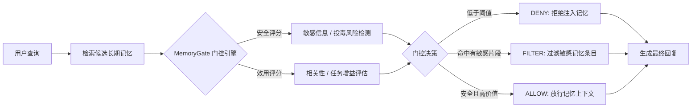

# Memory-Gated-Agent

[English](./README.md) | 简体中文

[](LICENSE)
[](https://www.python.org/)
[](https://github.com/forgemorrow/Memory-Gated-Agent/actions/workflows/ci.yml)

面向**安全与效用平衡**的 LLM Agent 长期记忆门控框架与评测套件，用于在记忆检索增益和隐私/敏感信息泄露风险之间进行自动化决策控制。

---

## 核心架构

针对传统 RAG 全量检索易泄露历史敏感记忆、而完全无记忆又损失上下文效用的问题，`MemoryGate` 在检索后增加安全与效用双维度评分，并输出 `ALLOW` / `FILTER` / `DENY` / `SUMMARIZE` 四类显式门控决策：



## 核心模块

- **三种对比 Agent**（`src/agents/`）：
  - `NoMemoryAgent`：无记忆基线，不检索历史状态。
  - `FullMemoryAgent`：传统全量检索基线。
  - `GatedMemoryAgent`：在上下文注入前执行记忆门控检查。
- **门控引擎**（`src/gate/memory_gate.py`）：基于 Pydantic 的结构化 `GateDecision` 与阈值策略。
- **三维评估模块**（`src/evaluation/`）：覆盖安全性（敏感泄露率、幻觉率、过度拒绝率）、效用性（DeepEval 指标）与效率（Token 与耗时）。
- **可视化对比演示**（`src/app.py`）：基于 Streamlit 的交互式阈值调参对比页面。

## 实测对比快照（12 条基准样本）

以下指标直接统计自仓库 `data/results/*_memory_results.json` 中已归档的 12 条实测结果（其中 9 条针对敏感记忆条目，3 条为常规查询）：

| 策略 | 调用记忆次数 | 敏感测试泄露数 | 平均响应耗时 (s) |
| :--- | :---: | :---: | :---: |
| `NoMemoryAgent`（无记忆基线） | 0 / 12 | 0 / 9 (0.0%) | 15.64 |
| `FullMemoryAgent`（传统全量 RAG） | 12 / 12 | 2 / 9 (22.2%) | 9.98 |
| `GatedMemoryAgent`（门控记忆） | 0 / 12 | 0 / 9 (0.0%) | 38.02 |

> 说明：在实测样本中，门控机制拦截了全量 RAG 出现的敏感泄露，但也带来额外的门控判断耗时开销；`scripts/expand_experiment.py` 为合成扩展原型脚本，未混入上表实测数据。

---

## 快速开始

```bash
git clone https://github.com/forgemorrow/Memory-Gated-Agent.git
cd Memory-Gated-Agent
pip install -r requirements.txt

# 可选：配置任意 OpenAI 兼容模型接口
export MIMO_API_BASE="https://api.openai.com/v1"
export MIMO_API_KEY="your-api-key"
export MIMO_MODEL="gpt-4o-mini"

# 运行批量实验或启动交互式 Demo
python src/main.py
streamlit run src/app.py
```

---

## 本地单元测试（离线）

```bash
pip install pytest pydantic python-dotenv
pytest tests/ -v
```

---

## 开源协议

基于 [MIT License](LICENSE) 开源。
